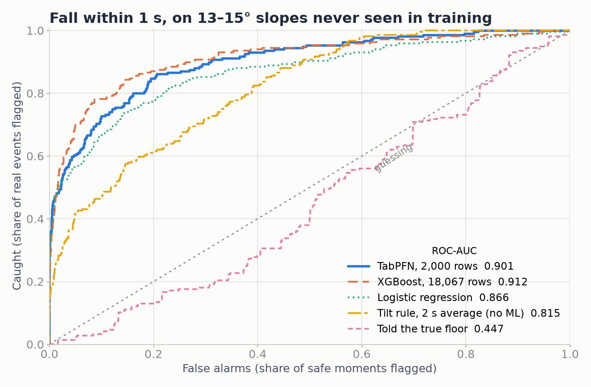
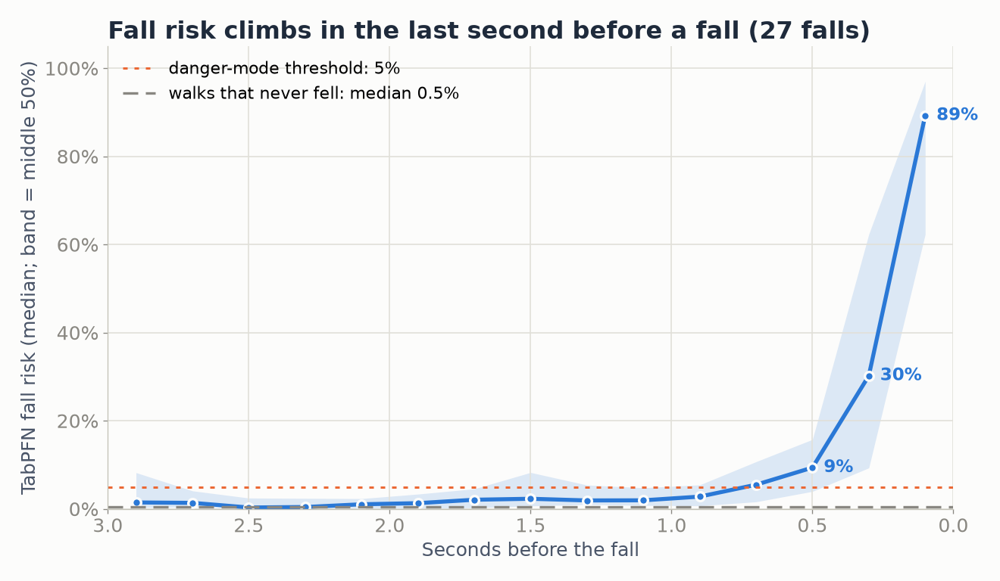
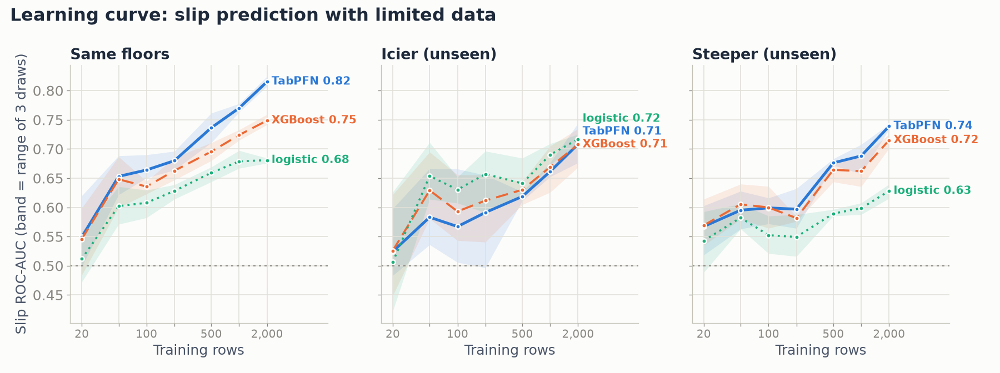
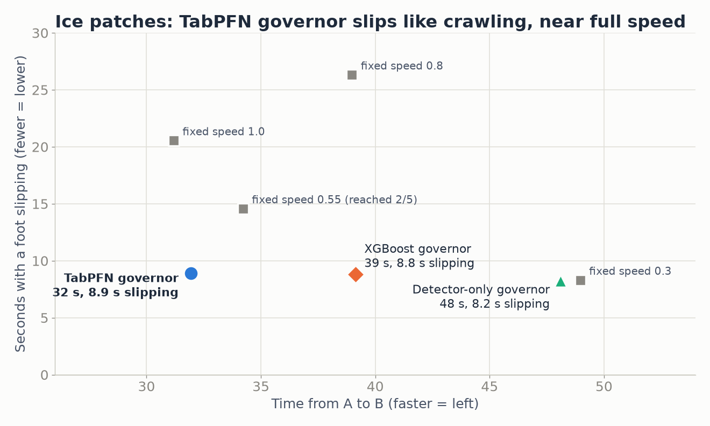

# Hacklab

## How to use

```python a1_navigation.py```: Run mujoco simulation with Unitree A1 robot navigating in an environment.

```python a1_lidar.py```: Run mujoco simulation with Unitree A1 robot with LiDAR sensors navigating in an environment.

```python a1_dataset.py```: Simulated datasets (/datasets/env_A.npz & env_B.npz).

### TabPFN collision safety filter

Needs `pip install mujoco tabpfn xgboost scikit-learn` (TabPFN runs locally on CPU, model v3.5-fast).

```python a1_collision_dataset.py```: Generates `datasets/collision_env_A.npz` / `collision_env_B.npz` (3000 samples each, ~15 min). Each sample is a lidar scan, the previous command, a candidate command, and whether holding that command for 0.8 s hits a box. The random-walk datasets above don't work for this: their 0.2 s label hardly depends on the command, so a model trained on them only learns "a box is close".

```python a1_collision_eval.py```: Offline test. It trains on env_A, tests on held-out env_A samples and on the unseen env_B layout, and compares TabPFN with a nearest-obstacle rule, logistic regression and XGBoost. The `cmd spread` column checks that the predicted risk changes with the command.

```python a1_safety_filter.py```: Live demo in the viewer. Every 0.2 s, TabPFN scores 21 candidate commands and the robot runs the one closest to "go to the goal" whose risk is below `--risk-limit` (default 0.15). Options: `--seed N` (different box layout), `--headless`, `--controller none|gap` (baselines), `--compare N` (every controller on seeds 0..N-1, summary table).

`a1_scenarios.py` defines the test scenes, all new to the model (it was trained on static scattered boxes only):
- static: `random`, `dense`, `large` (boxes bigger than any in training), `wall` (one off-centre gap), `corridor` (slalom between side walls)
- dynamic (blue mocap boxes): `crossing`, `oncoming`, `mixed`

Run one with `python a1_safety_filter.py --scenario crossing`, or all of them with `python a1_safety_filter.py --compare 3 --scenario all`.

`a1_planner.py` is an optional waypoint planner. It builds a 10 cm occupancy map from the lidar (moving boxes get cleared again when a ray passes through their old spot), inflates obstacles by the robot's half-width, and runs A* to the goal. Each controller then steers toward a point 0.8 m along the path instead of straight at the far goal. Turn it on with `--planner`; the path is drawn as green dots in the viewer. It uses the simulator's exact robot pose, so on a real robot it would need odometry or SLAM. Example: `python a1_safety_filter.py --scenario wall --planner`.

All 8 scenes × 3 seeds, totals out of 24 runs (`results/scenarios_no_planner.json`, `results/scenarios_planner.json`):

| controller | reached, no planner | reached, with planner | falls (no → with) | collision steps (no → with) |
|---|---|---|---|---|
| no filter | 6/24 | 23/24 | 18 → 1 | 383 → 31 |
| TabPFN filter | 6/24 | 23/24 | 5 → 1 | 163 → 58 |
| gap navigator | 18/24 | 21/24 | 3 → 2 | 810 → 214 |

The planner does most of the work. Once it's on, the TabPFN filter is no better than steering straight at the waypoints (more collision steps with moving boxes: 40 vs 22). The planner also uses exact robot pose from the simulator.

`a1_collision.py` holds the shared feature table (24 lidar sectors + command + previous command) and the TabPFN wrapper.

Results (CPU, TabPFN v3.5-fast, 1500 context rows, 4 estimators):

| test (env_B, unseen layout) | ROC-AUC | PR-AUC |
|---|---|---|
| nearest-obstacle rule | 0.952 | 0.865 |
| XGBoost | 0.984 | 0.948 |
| TabPFN | 0.989 | 0.957 |

| live, 5 random layouts | reached goal | falls | collision steps |
|---|---|---|---|
| no filter (straight to goal) | 2/5 | 3 | 52 |
| TabPFN safety filter | 4/5 | 0 | 4 |
| hand-tuned gap navigator (`a1_lidar.py`) | 5/5 | 0 | 1 |

### TabPFN slip and fall prediction

The task: predict, from the A1's own sensors only (IMU, joint angles/velocities, motor torques, foot forces, command), whether a foot slips in the next 0.2 s or the robot falls in the next 1 s. Friction (μ 0.1–1.0), slope (0–15°), random commands and pushes vary per episode, and the model is never told the friction or slope.

- `python a1_slip_dataset.py`: 400 episodes, about 25k samples, written to `datasets/slip.npz` (~4 min)
- `python a1_slip_eval.py`: compares TabPFN, XGBoost, logistic regression and privileged references on the same floors and on unseen icier/steeper floors; writes `results/slip_eval.json`
- `python a1_learning_curve.py`: accuracy against number of training rows (20–2000); writes `results/learning_curve.json`
- `python a1_floor_adapt.py`: does adding 10 s (100 rows) from a new floor help? Writes `results/floor_adapt.json`
- `python a1_slip_demo.py --risk fall`: paired episodes on unseen 13–15° slopes, where the robot slows down when TabPFN's fall risk is high; writes `results/slip_demo_fall.json`

Findings (ROC-AUC, 0.5 = guessing):
- With equal data, TabPFN is the best slip predictor from about 100 rows up on familiar floors (0.815 vs 0.749 for XGBoost at 2,000 rows). On unseen icy floors it has no edge (about 0.71 for every model). With 20–50 rows, every model is near guessing.
- Falls 1 s ahead on unseen 13–15° slopes: TabPFN 0.887, XGBoost 0.884. A model given the true floor drops to 0.447, so the body signals carry over to new slopes and the floor parameters don't.
- Adding 10 s from a new floor barely helps (0.709 → 0.711), and refitting TabPFN took 33–85 s on CPU.
- Slowing down on a fall warning didn't prevent falls (28/40 with and without). The open-loop gait has no way to recover.

**Making it better on new floors: short-history features** (`python a1_slip_history_eval.py`, `python a1_floor_adapt.py --features history`)

`a1_slip_dataset.py` now also records 11 history features the robot can compute itself. The main one is a legs-vs-IMU slip detector: leg kinematics say "the body moves at X", the integrated accelerometer says "Y", and a gap means the feet are sliding. It catches current slips with AUC 0.873. Its 0.1/0.5/2 s averages give the robot a sense of how slippery the floor has been lately. The other features are 0.5 s variability of joints, forces and gyro, and the 2 s mean tilt.

| Slip ROC-AUC, base → +history | TabPFN, 2,000 rows | XGBoost, 2,000 rows | XGBoost, all rows |
|---|---|---|---|
| same floors | 0.826 → 0.854 | 0.765 → 0.833 | 0.809 → 0.857 |
| icier (unseen) | 0.678 → 0.736 | 0.672 → 0.706 | 0.737 → 0.774 |
| icier + steeper (unseen) | 0.629 → 0.710 | 0.650 → 0.683 | 0.729 → 0.725 |

- History features help TabPFN most on unseen floors, and with equal data it now beats XGBoost there. The robot's own detector does as well as being told the true recent slip rate (0.736 vs 0.726, icier).
- Falls on unseen steep slopes got worse for TabPFN (0.887 → 0.851) while XGBoost improved (0.884 → 0.908). `python a1_fall_feature_check.py` confirms the cause: on 13–15° slopes, 27% of rows have a 2 s tilt average outside the training range. Dropping those 3 features gives TabPFN 0.901 / 0.914 (two different 2,000-row samples), against XGBoost's 0.912. Tilt averages alone drop it to 0.845 / 0.863. The difference between the two samples (about 0.015) is much smaller than the tilt effect (about 0.05). **For falls, use history features without the tilt averages.**
- Adding 10 s from a new floor now gives a small gain for TabPFN (0.723 → 0.736 over 6 floors) and a small loss for XGBoost (0.722 → 0.706). Shrinking the context to 300 + 100 rows makes things worse (0.693), even though the refit drops from about 47 s to about 8 s.

**Turning the warning into an action** (`python a1_recovery_demo.py --feasibility`, `python a1_recovery_demo.py --move brace`)

`a1_lidar.gait` now takes optional `stance` (wider feet), `crouch` (lower body) and `lift` (0 = stop stepping). With the defaults it's identical to before. Paired episodes on 40 unseen 13–15° slopes:

| move | falls | distance |
|---|---|---|
| unchanged gait | 28 | 1.69 m |
| slow, always on | 29 | 1.49 m |
| brace (wide + low + half speed), always on | **10** | 1.31 m |
| plant (stop, wide + low), always on | 11 | 0.38 m |
| brace when TabPFN fall risk > 0.2 (held 1 s) | 30 | 1.80 m |
| brace at random moments (same alarm rate) | 26 | 1.61 m |

Posture is the lever, not speed: bracing all the time cuts falls by about two-thirds. Bracing only on TabPFN's 1 s warning doesn't help, because the warning comes too late to change posture and the robot was braced for only 0.7 s per episode. On steep slopes falling builds up over the whole walk, so the brace has to start early.

**Danger mode** (`python a1_danger_mode.py`): brace while a signal says the floor is risky, and return to the normal gait after 3 s of quiet. Paired runs on 40 unseen steep floors (13–15°) and 40 safe floors (0–8°, any friction):

| controller | falls, steep | falls, safe | distance, safe | braced on safe floors |
|---|---|---|---|---|
| never brace | 28/40 | 0/40 | 2.07 m | 0% |
| always brace | 10/40 | 0/40 | 1.16 m | 88% |
| tilt rule (2 s IMU tilt > 10°, no ML) | 10/40 | 0/40 | 1.78 m | 26% |
| TabPFN fall risk > 5% | 13/40 | 0/40 | **2.07 m** | **1%** |

TabPFN prevents 15 of the 18 falls that always-bracing prevents, and costs nothing on safe floors. The simple tilt rule is a bit safer (10 vs 13 falls) but braces needlessly 26% of the time on safe floors. Neither threshold was tuned on these floors. The steep and safe slopes don't overlap (0–8° vs 13–15°), so a tuned tilt threshold could probably do as well; on real terrain, slopes aren't so cleanly separated.

**Against a stronger baseline: a balance controller** (`a1_balance.py`, `python a1_balance_tune.py`, `python a1_slip_dataset.py --balanced`)

The blind trot never reads a sensor. `a1_balance.Balancer` adds classic feedback reflexes on top of the same trot: lean the legs against sideways tilt, level the body by changing individual leg lengths, and damp rotation with the gyro. Foot placement (Raibert-style) is implemented, but tuning showed it didn't help. Gains were tuned on training slopes only (9–13°): the blind gait had 8 of 40 falls, the chosen `TUNED` gains (IMU only) 0 of 40 (`results/balance_tune.json`).

| same 40 unseen 13–15° slopes | falls |
|---|---|
| blind trot | 28 |
| blind trot + TabPFN danger mode | 13 |
| **balance reflex, no TabPFN** | **0** |

The balance reflex also had 0 falls on the 40 safe floors (`results/balancer_baseline.json`). In 400 data walks with the balancer, only 1 fell, so there are no fall examples to learn from and nothing left for a fall warning to prevent. **Falls here have one directly measurable cause, sideways tilt, so correcting it beats predicting it.** Slips still happen in 71% of moments with the balancer, and slip prediction on unseen floors remains TabPFN's useful role on this robot. Acting on slip risk on top of the balancer hasn't been tested yet.

**Charts** (`python a1_tabpfn_charts.py` → `results/figures/`, numbers in `results/charts_data.json`)

| | |
|---|---|
|  |  |
|  |  |



- Fall within 1 s on unseen slopes: TabPFN 0.901 (2,000 rows), XGBoost 0.912 (18,067 rows), logistic 0.866, 2 s tilt average 0.815, model told the true floor 0.447.
- Slip within 0.2 s on unseen icy + steep floors: TabPFN + slip detector 0.710, sensors only 0.629, XGBoost + detector 0.683 (2,000 rows) / 0.725 (10,290 rows).
- Lead time: TabPFN's median fall risk is 0.5% on walks that never fell, and 9% / 30% / 89% at 0.5 / 0.3 / 0.1 s before a fall. The warning is accurate but late.

**Unseen real terrain** (`a1_terrain.py`, `python a1_terrain_test.py` → `results/terrain_test.json`)

In every other experiment, slopes are tilted gravity on a flat floor. `a1_terrain.py` builds real rolling hills instead: a heightfield with slopes up to 28° that change as the robot walks, normal gravity, and a checker-textured ground tinted by friction (green = grippy, pale blue = icy). The fall check measures height above the ground under the robot. **Nothing is retrained:** every model keeps its original examples or training data.

| fall within 1 s, ROC-AUC | TabPFN | XGBoost (9× data) | logistic | tilt rule |
|---|---|---|---|---|
| steep hills (avg slope 16°) | 0.859 | 0.888 | 0.805 | 0.829 |
| moderate hills (avg slope 11°) | 0.944 | 0.970 | 0.810 | 0.824 |

| falls in 30 + 30 paired hill walks | blind | always brace | tilt rule | TabPFN danger mode | balance reflex |
|---|---|---|---|---|---|
| falls | 28 | 16 | 17 | 19 | **0** |
| mean distance | 1.07 m | 0.82 m | 0.84 m | 0.97 m | 1.40 m |

The pattern from the flat slopes holds on real terrain. TabPFN's fall warning transfers well: it beats logistic regression and the tilt rule, but stays slightly behind XGBoost trained on 9× the data. Danger mode cuts falls while walking further than always bracing, and the balance reflex is best on both counts.


**Can the warning be improved? And does it help a robot that balances?** (`python a1_improve_test.py part2|part3`)

Thresholds follow one rule fixed in advance (5× the label's base rate in the training examples), and TabPFN's examples still come only from the original flat floors.

| unseen hills, blind gait (60 walks) | falls | distance |
|---|---|---|
| TabPFN, 1 s warning, hold 3 s | 19 | 0.97 m |
| TabPFN, "fall within 2.5 s" examples, hold 5 s | 18 | 0.88 m |
| … + plant all feet while risk > 26% | 17 | 0.82 m |
| always brace (the ceiling for any warning) | 16 | 0.82 m |

| stress test, balance reflex on: hills up to 35°, shoves up to 120 N (30 new walks) | falls |
|---|---|
| reflex alone | 4 |
| reflex + always brace | 3 |
| reflex + tilt rule | 2 |
| reflex + TabPFN (1 s / early / early + plant) | 3 / 3 / 3 |

An earlier warning only gets the blind robot closer to always bracing, because the limit is the brace itself, not the prediction. On top of the balance reflex, every add-on prevented 2 falls and caused 1, which is within noise for 30 walks. **On a robot that balances itself, TabPFN's fall warning adds nothing measurable here.**

**Where TabPFN wins: choosing speed and route on ice patches** (`a1_ice_patches.py`, videos: `python a1_ice_videos.py`)

The scene is flat green ground with white ice patches (friction 0.1) on the way from A to B. The robot can't see the ice, only feel it. The TabPFN slip model is frozen: its examples are whole floors from the original data, never patches.

*Speed governor* (`python a1_ice_patches.py governor`, plus `governor_baseline` and `governor_xgb`). Every 0.2 s it scores 4 speeds and takes the fastest one whose predicted slip risk is under the limit. Means over 5 layouts:

| strategy | time A→B | seconds slipping |
|---|---|---|
| fixed full speed | 31.2 s | 20.5 s |
| fixed crawl (0.3) | 49.0 s | 8.3 s |
| detector-only governor (4 slip-detector features, logistic) | 48.1 s | 8.2 s |
| XGBoost governor (same 62 features, 10,290 rows) | 39.1 s | 8.8 s |
| **TabPFN governor** | **32.0 s** | **8.9 s** |

TabPFN slips about as little as crawling at nearly full speed, and it held on every layout. XGBoost reaches the same slip level 7 s slower. The detector-only model can't tell ice from grip (median risk 0.53 vs 0.55, against TabPFN's 0.42 vs 0.88), so it crawls everywhere.

*Patrol with a slip map* (`python a1_ice_patches.py patrol`). The robot walks A↔B six times. Its slip risk goes into a grid map, and A* routes around high-risk cells. From leg 3 on, it slips 4.6 s per leg with the TabPFN map, 8.4 s with a detector-only map and 14.4 s with no map. Honestly, by legs 4–6 both maps end up similar (medians 2–4 s). TabPFN's edge is steadier learning: the detector map routes back into the ice on leg 3.




**Videos** (`python a1_record_videos.py` → `videos/*.mp4`, offscreen rendering, needs `pip install imageio imageio-ffmpeg`)

Exact replays of logged episodes, with the brace indicator (blue = braced), sliding feet (red), downhill arrow and a text label: `blind_falls`, `tabpfn_braces`, `balance_reflex`, `always_brace` (steep episode 9), `tilt_safe_floor`, `tabpfn_safe_floor` (safe episode 30), and side-by-side `episode9_comparison.mp4` (blind | TabPFN | balance reflex) and `safe_floor_comparison.mp4` (tilt rule | TabPFN). On real hills: `hills_ice_comparison.mp4` (icy, steep episode 12) and `hills_comparison.mp4` (steep episode 24), each blind | TabPFN | balance reflex.

`python a1_slip_viewer.py` shows the robot live on a chosen floor, with sliding feet in red and TabPFN's fall risk as a coloured ball.

#### Notebooks
fit_tabPFN.ipynb: should fit the tabPFN model and do the data wrangling (create a table out of the data).


Simulation environments:

https://pybullet.org/

https://github.com/google-deepmind/mujoco

TabPFN Demo:
https://colab.research.google.com/github/PriorLabs/TabPFN/blob/main/examples/notebooks/TabPFN_Demo_Local.ipynb
