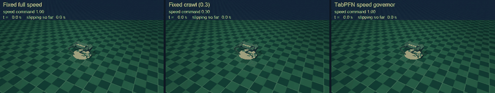
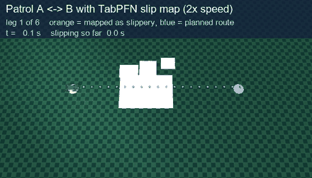
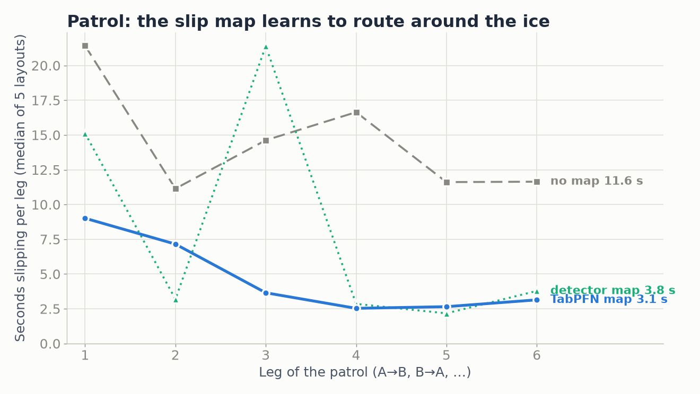
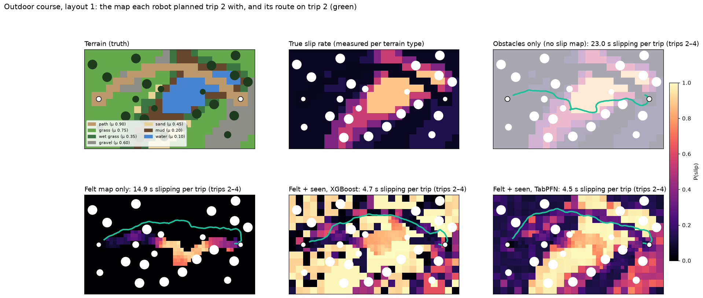
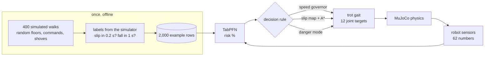
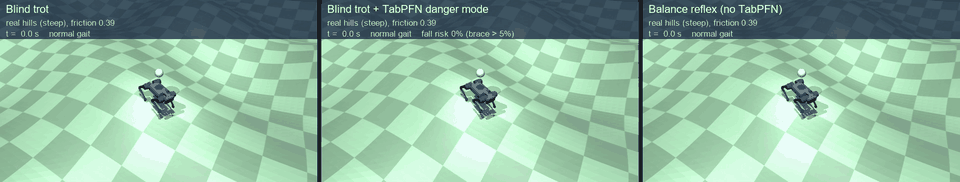
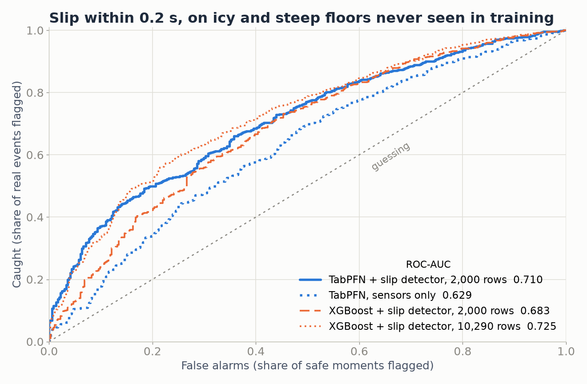
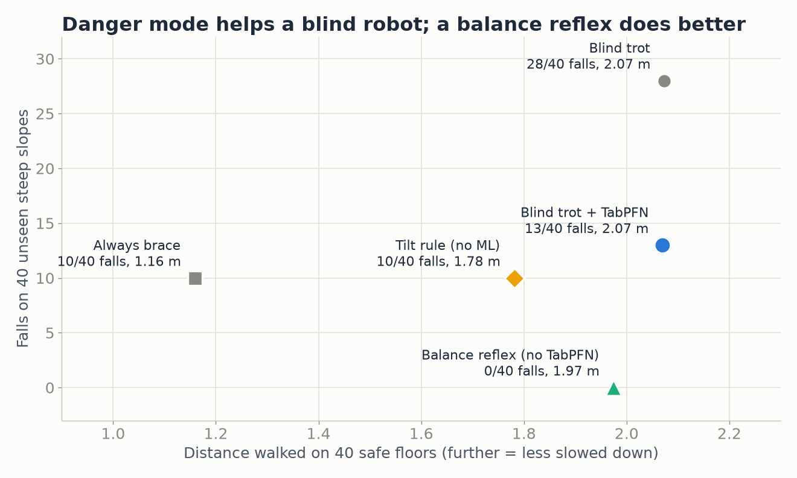
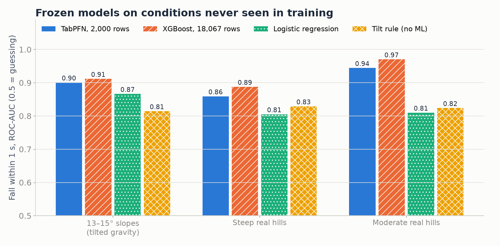

# Can a robot dog learn where the ice is from a table?

**TabPFN on a simulated Unitree A1.** The robot reads only its own body sensors. With 2,000 example rows and no training, it decides how fast it can safely walk, remembers where the ice was and learns on site what slippery ground looks like.



*Same ice-patch course, same start. Left: fixed full speed (slips a lot). Middle: crawling (slow). Right: **TabPFN choosing the speed** (fast with few slips). White = ice, green = grip. 2× speed.*

<table>
<tr>
<td align="center"><b>32.0 s</b><br/>A → B on hidden ice with TabPFN choosing the speed<br/><sub>crawling takes 49.0 s for about the same slipping</sub></td>
<td align="center"><b>3×</b><br/>less slipping per trip once the slip map has learned the ice<br/><sub>4.6 s against 14.4 s with no map</sub></td>
<td align="center"><b>5×</b><br/>less slipping outdoors after one trip of learning on site<br/><sub>4.5 s against 23.0 s with no slip map</sub></td>
</tr>
</table>

**See every result in a few seconds, with only Python and numpy:**

```bash
python tour.py   # reads results/*.json; needs no TabPFN, GPU or simulator
```

---

## The problem

A legged robot cannot see whether the floor ahead is icy. It finds out when a foot slides and on a slope or at speed that can already mean a fall. The usual options each have a cost: walk slowly everywhere and lose most of the robot's speed or train a controller over millions of simulated steps and retrain it when the ground changes.

We asked whether a tabular foundation model can fill that gap in context. Each moment of walking becomes one row of a table: what the robot senses and what happened next. TabPFN gets a few thousand such rows as examples and is asked about the moment the robot is in right now. Its weights never change.

## Results

### 1. Choosing a safe speed on ice it cannot see

Every 0.2 s the robot asks TabPFN for the slip risk at 4 candidate speeds (0.3, 0.55, 0.8 and 1.0) and walks at the fastest one below a 65% risk limit. The ice patches (friction 0.1) are invisible to it. TabPFN's examples come from whole floors in the original data and never from patches.

| ice patches, A → B, 5 layouts the model never saw | time | seconds slipping |
|---|---|---|
| fixed full speed | 31.2 s | 20.5 s |
| fixed crawl | 49.0 s | 8.3 s |
| detector-only model (4 slip-detector features, logistic regression) | 48.1 s | 8.2 s |
| XGBoost choosing the speed (same 62 features, same rule, 10,290 rows) | 39.1 s | 8.8 s |
| **TabPFN choosing the speed (2,000 rows)** | **32.0 s** | **8.9 s** |

TabPFN slips about as little as crawling at close to full speed and it reached B on every layout. XGBoost gets to the same slip level 7 s later. The detector-only model cannot separate ice from grip (median risk 0.55 on ice and 0.53 on grip, against TabPFN's 0.88 and 0.42), so it crawls everywhere.

<p align="center"></p>

`python a1_ice_patches.py governor`

### 2. Remembering where the ice was

The robot walks A ↔ B six times. Each slip prediction is written into a grid map of the ground and an A* planner routes around high-risk cells on the next trip.

| patrol, legs 3–6, 5 layouts | mean slipping per leg | median |
|---|---|---|
| no map | 14.4 s | 13.4 s |
| map from the slip detector only | 8.4 s | 3.0 s |
| **map from TabPFN** | **4.6 s** | **2.6 s** |

By legs 4–6 both maps reach similar medians. The TabPFN map learns more steadily: the detector map sends the robot back into the ice on leg 3.

| Patrol: the slip map fills in where the ice is | Slipping per leg over the patrol |
|---|---|
|  |  |

`python a1_ice_patches.py patrol`

### 3. Outdoors: learning on site what slippery looks like

A 12 × 7 m world of 0.5 m tiles: path, grass, wet grass, sand, gravel, mud and water, with trees and rocks as solid obstacles. Sand, mud and water are soft and gravel is bumpy. A pond with a mud rim always lies across the straight line from A to B.

Here TabPFN gets a different job. Every 0.2 s the robot adds one row: what the tile under it looks like to a camera (colour and roughness, with noise) and whether it just felt slippery. Every 2 s, a TabPFN fitted on only these rows from this site (tens to a few hundred, no other sites) predicts the slip risk of every tile the robot has not walked on yet. Trees and rocks are treated as known, as they would be from lidar.

| outdoor patrol A → B → A → B, 3 layouts | slipping, trip 1 | slipping per trip, trips 2–4 | in mud or water per trip | time per trip |
|---|---|---|---|---|
| obstacles only (no slip map) | 41.1 s | 23.0 s | 29.6 s | 42.8 s |
| felt map only (where it walked) | 18.6 s | 14.9 s | 14.7 s | 32.2 s |
| felt + seen, XGBoost (same rows) | 40.5 s | 4.7 s | 12.4 s | 33.2 s |
| **felt + seen, TabPFN** | 27.3 s | **4.5 s** | **7.8 s** | **28.7 s** |

Once the map has examples, TabPFN and XGBoost avoid slipping about equally. The difference is false alarms: XGBoost marks 34% of safe unwalked tiles as risky, TabPFN 17%, so TabPFN's routes are shorter and spend less time in mud and water. Both rank tiles similarly well (ROC-AUC 0.907 for TabPFN, 0.926 for XGBoost).



*Layout 1: the true terrain, its measured slip rate and the map each strategy planned trip 2 with. Green line = the route actually walked.*

`python a1_outdoor.py experiment`

### 4. Prediction on ground it has never seen

| frozen model, never retrained | TabPFN (2,000 rows) | XGBoost | logistic regression | rule, no ML |
|---|---|---|---|---|
| slip within 0.2 s, unseen icy floors | **0.736** | 0.706 (2,000 rows) | | |
| fall within 1 s, unseen 13–15° slopes | 0.901 | 0.912 (18,067 rows) | 0.866 | 0.815 (tilt) |
| fall within 1 s, real rolling hills, steep | 0.859 | 0.888 (18,067 rows) | 0.805 | 0.829 (tilt) |
| fall within 1 s, real rolling hills, moderate | 0.944 | 0.970 (18,067 rows) | 0.810 | 0.824 (tilt) |

ROC-AUC, 0.5 = guessing. With equal data TabPFN is the best slip predictor on unseen floors. For falls it stays close to XGBoost trained on 9× the data.

## Why TabPFN

- **No training loop.** The examples are stored, never trained on. Outdoors the robot adds a row every 0.2 s and refits every 2 s from whatever it has collected on that site.
- **Useful from very few rows.** On the outdoor course the on-site table starts empty and grows to tens or a few hundred rows. That is enough to map the ground the robot has not walked on.
- **Risk that responds to the action.** The speed governor only works if predicted risk rises with speed on ice and stays low on grip. TabPFN's risk does that clearly enough to walk fast on grip and slow down on ice. With the same features and rule, XGBoost and the detector-only model are more cautious and slower.
- **Fewer false alarms.** Outdoors it flags half as many safe tiles as XGBoost, which turns directly into shorter routes.

## How it works

1. **Simulate and label.** 400 walks of a MuJoCo Unitree A1 with a blind trot, on random friction (0.1–1.0), slopes (0–15°), commands and shoves. Every 0.1 s we save one row of what the robot can sense and label it from the simulator: did a foot slip within 0.2 s? did the robot fall within 1 s?
2. **Store, don't train.** 2,000 labelled rows become TabPFN's examples (local `v3.5-fast` on CPU).
3. **Predict live.** Every 0.1–0.2 s the robot's current 62 sensor numbers go in as one row and a probability comes out.
4. **Act.** A simple rule turns the probability into movement: choose a speed, write it into a slip map for A* or brace against a fall.



**The 62 numbers in each row**

| group | count |
|---|---|
| IMU: gravity direction, gyro, accelerometer | 9 |
| joint angles, joint speeds, motor torques (12 joints each) | 36 |
| foot contact forces | 4 |
| command (forward, turn) | 2 |
| history: legs-vs-IMU slip detector and its 0.1 / 0.5 / 2 s averages, 0.5 s variability of joints, forces and gyro, 2 s mean tilt | 11 |

The slip detector compares two estimates of body speed: one from leg kinematics and one from the integrated accelerometer. A gap between them means the feet are sliding. On a real A1 it can provide the slip labels the simulator provides here.

## What did not work

We kept the negative results because they show where this approach fits.

- **Fall prevention.** Acting on TabPFN's fall warning cut falls of the blind robot from 28 to 13 out of 40 on steep slopes. A simple IMU balance reflex has 0 falls and TabPFN adds nothing measurable on top of it. Falls here have one directly measurable cause, sideways tilt, so correcting it works better than predicting it.
- **Frozen slip model outdoors.** The body-sensor model from the flat floors does not transfer to soft, bumpy outdoor tiles (it rates every terrain 0.72–0.93). That is why the outdoor robot uses the slip it feels and learns appearance on site.
- **More examples, worse governor.** With 5,000 instead of 2,000 examples, offline slip ROC-AUC rose from 0.681 to 0.768 but the governor got worse (45.0 s, 26.4 s slipping), because full speed on ice dropped just under the risk limit. The threshold has to be re-checked whenever the model changes.
- **Lidar collision filter (first attempt).** A lidar occupancy map with A* solved navigation among boxes. A TabPFN collision filter on top added nothing.

**Limits.** Simulation only. Small samples: 5 layouts per ice test, 3 outdoor layouts, 30–60 walks per fall test. The patrol uses the simulator's exact position, so a real robot would need odometry or SLAM. Each decision takes about 0.26 s on a laptop CPU.



*Real hills never seen in training. Left to right: blind trot, TabPFN danger mode, balance reflex.*

## Run it

```bash
pip install torch==2.15.0 --index-url https://download.pytorch.org/whl/cpu
pip install -r requirements.txt
```

TabPFN runs locally on CPU (model `v3.5-fast`). The first run downloads the weights, which needs the TabPFN licence accepted (see [docs.priorlabs.ai](https://docs.priorlabs.ai)). The MuJoCo Menagerie A1 model is cloned automatically on first use. All results were produced with Python 3.13 and the versions in `requirements.txt`.

| what | command |
|---|---|
| summary of all results, no setup | `python tour.py` |
| speed governor on ice patches | `python a1_ice_patches.py governor` |
| slip-map patrol | `python a1_ice_patches.py patrol` |
| outdoor course experiment / figure / video | `python a1_outdoor.py experiment` / `python a1_outdoor.py figure` / `python a1_outdoor_video.py` |
| ice videos (the GIFs above) | `python a1_ice_videos.py` |
| live viewer: sliding feet and fall risk | `python a1_slip_viewer.py --mu 0.15 --slope 13.5` |
| frozen models on real hills | `python a1_terrain_test.py` |
| regenerate the training data (~4 min) | `python a1_slip_dataset.py` |
| redraw all charts | `python a1_tabpfn_charts.py` |

## Repository layout

| files | what |
|---|---|
| `tour.py` | no-setup summary of all results |
| `a1_lidar.py`, `a1_balance.py` | A1 scene, trot gait (with posture options), balance reflex |
| `a1_slip_dataset.py` | data generation, sensors, legs-vs-IMU slip detector, `run_episode` |
| `a1_collision.py` | TabPFN wrapper (`CollisionRisk`, generic despite the name) |
| `a1_ice_patches.py`, `a1_ice_videos.py` | ice-patch course: speed governor, slip-map patrol, videos |
| `a1_outdoor.py`, `a1_outdoor_figure.py`, `a1_outdoor_video.py` | outdoor course: on-site TabPFN slip map from appearance |
| `a1_terrain.py`, `a1_terrain_test.py` | real hill terrain, frozen-model test |
| `a1_slip_eval.py`, `a1_slip_history_eval.py`, `a1_learning_curve.py`, `a1_fall_feature_check.py`, `a1_floor_adapt.py` | offline prediction tests |
| `a1_recovery_demo.py`, `a1_danger_mode.py`, `a1_improve_test.py`, `a1_balance_tune.py` | fall warning → action, balance reflex |
| `a1_danger_replay.py`, `a1_slip_viewer.py`, `a1_record_videos.py` | viewers, replays, videos |
| `a1_tabpfn_charts.py` | all charts → `results/figures/` |
| `a1_safety_filter.py`, `a1_scenarios.py`, `a1_planner.py`, `a1_collision_*.py` | first attempt: lidar collision filter, scenes, A* planner |
| `a1_navigation.py`, `a1_dataset.py` | original A1 navigation and lidar datasets |
| `datasets/`, `results/`, `docs/` | data, results (JSON and figures), README GIFs |

---

## Full experiment log

Every number below comes from a JSON file in `results/`. Click a section to expand it.

<details>
<summary><b>Slip and fall prediction from body sensors</b></summary>

The task: predict from the A1's own sensors (IMU, joint angles and speeds, motor torques, foot forces, command) whether a foot slips in the next 0.2 s or the robot falls in the next 1 s. Friction (μ 0.1–1.0), slope (0–15°), random commands and pushes vary per episode and the model is never told the friction or slope.

- `python a1_slip_dataset.py`: 400 episodes, about 25k samples, written to `datasets/slip.npz` (~4 min)
- `python a1_slip_eval.py`: compares TabPFN, XGBoost, logistic regression and privileged references on the same floors and on unseen icier and steeper floors; writes `results/slip_eval.json`
- `python a1_learning_curve.py`: accuracy against number of training rows (20–2,000); writes `results/learning_curve.json`
- `python a1_floor_adapt.py`: does adding 10 s (100 rows) from a new floor help? Writes `results/floor_adapt.json`
- `python a1_slip_demo.py --risk fall`: paired episodes on unseen 13–15° slopes, where the robot slows down when TabPFN's fall risk is high; writes `results/slip_demo_fall.json`

Findings (ROC-AUC, 0.5 = guessing):
- With equal data, TabPFN is the best slip predictor from about 100 rows up on familiar floors (0.815 against 0.749 for XGBoost at 2,000 rows). With sensor features only it has no edge on unseen icy floors (about 0.71 for every model). With 20–50 rows every model is near guessing.
- Falls 1 s ahead on unseen 13–15° slopes: TabPFN 0.887, XGBoost 0.884. A model given the true floor drops to 0.447, so the body signals carry over to new slopes and the floor parameters do not.
- Adding 10 s from a new floor barely helps (0.709 → 0.711) and refitting TabPFN took 33–85 s on CPU.
- Slowing down on a fall warning did not prevent falls (28/40 with and without). The open-loop gait has no way to recover.

**Short-history features** (`python a1_slip_history_eval.py`, `python a1_floor_adapt.py --features history`)

`a1_slip_dataset.py` also records 11 history features the robot can compute itself. The main one is the legs-vs-IMU slip detector, which catches current slips with AUC 0.873. Its 0.1 / 0.5 / 2 s averages give the robot a sense of how slippery the floor has been lately. The other features are the 2 s mean tilt and the 0.5 s variability of joints, forces and gyro.

| Slip ROC-AUC, base → +history | TabPFN, 2,000 rows | XGBoost, 2,000 rows | XGBoost, all rows |
|---|---|---|---|
| same floors | 0.826 → 0.854 | 0.765 → 0.833 | 0.809 → 0.857 |
| icier (unseen) | 0.678 → 0.736 | 0.672 → 0.706 | 0.737 → 0.774 |
| icier + steeper (unseen) | 0.629 → 0.710 | 0.650 → 0.683 | 0.729 → 0.725 |

- History features help TabPFN most on unseen floors and with equal data it beats XGBoost there. The robot's own detector does as well as being told the true recent slip rate (0.736 against 0.726, icier).
- Falls on unseen steep slopes got worse for TabPFN (0.887 → 0.851) while XGBoost improved (0.884 → 0.908). `python a1_fall_feature_check.py` shows why: on 13–15° slopes, 27% of rows have a 2 s tilt average outside the training range. Dropping those 3 features gives TabPFN 0.901 / 0.914 (two different 2,000-row samples) against XGBoost's 0.912. The difference between the two samples (about 0.015) is much smaller than the tilt effect (about 0.05). For falls, use history features without the tilt averages.
- Adding 10 s from a new floor now gives a small gain for TabPFN (0.723 → 0.736 over 6 floors) and a small loss for XGBoost (0.722 → 0.706). Shrinking the context to 300 + 100 rows makes things worse (0.693), even though the refit drops from about 47 s to about 8 s.

| | |
|---|---|
|  |  |
|  |  |


- Fall within 1 s on unseen slopes: TabPFN 0.901 (2,000 rows), XGBoost 0.912 (18,067 rows), logistic 0.866, 2 s tilt average 0.815, model told the true floor 0.447.
- Slip within 0.2 s on unseen icy and steep floors: TabPFN + slip detector 0.710, sensors only 0.629, XGBoost + detector 0.683 (2,000 rows) / 0.725 (10,290 rows).
- Lead time: TabPFN's median fall risk is 0.5% on walks that never fell and 9% / 30% / 89% at 0.5 / 0.3 / 0.1 s before a fall. The warning is accurate but late.

Charts: `python a1_tabpfn_charts.py` → `results/figures/`, numbers in `results/charts_data.json`.

</details>

<details>
<summary><b>Turning the fall warning into an action: brace, danger mode, balance reflex</b></summary>

**Posture** (`python a1_recovery_demo.py --feasibility`, `python a1_recovery_demo.py --move brace`)

`a1_lidar.gait` takes optional `stance` (wider feet), `crouch` (lower body) and `lift` (0 = stop stepping). With the defaults it is identical to the plain trot. Paired episodes on 40 unseen 13–15° slopes:

| move | falls | distance |
|---|---|---|
| unchanged gait | 28 | 1.69 m |
| slow, always on | 29 | 1.49 m |
| brace (wide + low + half speed), always on | **10** | 1.31 m |
| plant (stop, wide + low), always on | 11 | 0.38 m |
| brace when TabPFN fall risk > 0.2 (held 1 s) | 30 | 1.80 m |
| brace at random moments (same alarm rate) | 26 | 1.61 m |

Posture matters more than speed: bracing all the time cuts falls by about two-thirds. Bracing only on TabPFN's 1 s warning does not help, because the warning comes too late to change posture and the robot was braced for only 0.7 s per episode.

**Danger mode** (`python a1_danger_mode.py`): brace while a signal says the floor is risky and return to the normal gait after 3 s of quiet. Paired runs on 40 unseen steep floors (13–15°) and 40 safe floors (0–8°, any friction):

| controller | falls, steep | falls, safe | distance, safe | braced on safe floors |
|---|---|---|---|---|
| never brace | 28/40 | 0/40 | 2.07 m | 0% |
| always brace | 10/40 | 0/40 | 1.16 m | 88% |
| tilt rule (2 s IMU tilt > 10°, no ML) | 10/40 | 0/40 | 1.78 m | 26% |
| TabPFN fall risk > 5% | 13/40 | 0/40 | **2.07 m** | **1%** |

TabPFN prevents 15 of the 18 falls that always-bracing prevents and costs nothing on safe floors. The tilt rule is a bit safer (10 against 13 falls) but braces needlessly 26% of the time on safe floors. Neither threshold was tuned on these floors and since steep and safe slopes do not overlap here, a tuned tilt threshold could probably do as well.

**A stronger baseline: a balance controller** (`a1_balance.py`, `python a1_balance_tune.py`, `python a1_slip_dataset.py --balanced`)

`a1_balance.Balancer` adds classic feedback reflexes on top of the same trot: lean the legs against sideways tilt, level the body by changing individual leg lengths and damp rotation with the gyro. Raibert-style foot placement is implemented but did not help in tuning. Gains were tuned on training slopes only (9–13°): the blind gait had 8 of 40 falls there, the chosen `TUNED` gains (IMU only) 0 of 40 (`results/balance_tune.json`).

| same 40 unseen 13–15° slopes | falls |
|---|---|
| blind trot | 28 |
| blind trot + TabPFN danger mode | 13 |
| **balance reflex, no TabPFN** | **0** |

The balance reflex also had 0 falls on the 40 safe floors (`results/balancer_baseline.json`). In 400 data walks with the balancer only 1 fell, so there is nothing left for a fall warning to prevent. Slips still happen in 71% of moments with the balancer, which is why the rest of the project focuses on slip prediction.

**Can the warning be improved? Does it help a robot that balances?** (`python a1_improve_test.py part2|part3`)

Thresholds follow one rule fixed in advance (5× the label's base rate in the training examples) and TabPFN's examples still come only from the original flat floors.

| unseen hills, blind gait (60 walks) | falls | distance |
|---|---|---|
| TabPFN, 1 s warning, hold 3 s | 19 | 0.97 m |
| TabPFN, "fall within 2.5 s" examples, hold 5 s | 18 | 0.88 m |
| … + plant all feet while risk > 26% | 17 | 0.82 m |
| always brace (the ceiling for any warning) | 16 | 0.82 m |

| stress test with balance reflex: hills up to 35°, shoves up to 120 N (30 new walks) | falls |
|---|---|
| reflex alone | 4 |
| reflex + always brace | 3 |
| reflex + tilt rule | 2 |
| reflex + TabPFN (1 s / early / early + plant) | 3 / 3 / 3 |

An earlier warning only brings the blind robot closer to always bracing, because the brace itself is the limit. On top of the balance reflex every add-on prevented 2 falls and caused 1, which is within noise for 30 walks.

</details>

<details>
<summary><b>Unseen real terrain: rolling hills</b></summary>

In the other fall experiments, slopes are tilted gravity on a flat floor. `a1_terrain.py` builds real rolling hills: a heightfield with slopes up to 28° that change as the robot walks, normal gravity and a checker-textured ground tinted by friction (green = grippy, pale blue = icy). The fall check measures height above the ground under the robot. Nothing is retrained (`python a1_terrain_test.py` → `results/terrain_test.json`).

| fall within 1 s, ROC-AUC | TabPFN | XGBoost (9× data) | logistic | tilt rule |
|---|---|---|---|---|
| steep hills (avg slope 16°) | 0.859 | 0.888 | 0.805 | 0.829 |
| moderate hills (avg slope 11°) | 0.944 | 0.970 | 0.810 | 0.824 |

| 30 + 30 paired hill walks | blind | always brace | tilt rule | TabPFN danger mode | balance reflex |
|---|---|---|---|---|---|
| falls | 28 | 16 | 17 | 19 | **0** |
| mean distance | 1.07 m | 0.82 m | 0.84 m | 0.97 m | 1.40 m |

The pattern from the flat slopes holds. TabPFN's fall warning transfers: it beats logistic regression and the tilt rule and stays slightly behind XGBoost trained on 9× the data. Danger mode cuts falls while walking further than always bracing and the balance reflex is best on both counts.



</details>

<details>
<summary><b>Ice patches: governor and patrol details</b></summary>

The scene is flat green ground with white ice patches (friction 0.1) between A and B. The robot cannot see the ice, only feel it. The TabPFN slip model is frozen and its examples are whole floors from the original data, never patches.

*Speed governor* (`python a1_ice_patches.py governor`, plus `governor_baseline` and `governor_xgb`): see the table in [Results](#1-choosing-a-safe-speed-on-ice-it-cannot-see). At a 0.5 risk limit TabPFN takes 38.5 s with 8.8 s slipping.

*More examples do not give a better governor* (`results/ice_governor_5000.json`). With 5,000 instead of 2,000 examples, offline slip ROC-AUC on unseen icy and steep floors rises from 0.681 to 0.768 and decisions are no slower (about 260 ms). The governor gets worse: 45.0 s with 26.4 s slipping at the 0.65 limit (38.5 s / 8.8 s at 0.5). The 5,000-example model rates full speed on ice slightly lower (0.84 against 0.88, even below 0.8 speed), so 10% of icy moments pass the 0.65 limit instead of 3% and the robot runs onto the ice. The controller depends on how risk changes with speed, not on overall accuracy.

*Patrol with a slip map* (`python a1_ice_patches.py patrol`): the robot walks A ↔ B six times; slip risk goes into a grid map and A* routes around high-risk cells. From leg 3 on it slips 4.6 s per leg with the TabPFN map, 8.4 s with a detector-only map and 14.4 s with no map. By legs 4–6 both maps end up similar (medians 2–4 s); the detector map routes back into the ice on leg 3.

</details>

<details>
<summary><b>Outdoor course details</b></summary>

`a1_outdoor.py` builds a 12 × 7 m MuJoCo world of 0.5 m terrain tiles, each with its own friction. A dirt path winds around a pond with a mud rim. Each terrain's true slip rate was measured by walking a floor made only of it (`python a1_outdoor.py calibrate`):

| | path | grass | sand | gravel | wet grass | mud | water |
|---|---|---|---|---|---|---|---|
| friction | 0.90 | 0.75 | 0.45 | 0.60 | 0.35 | 0.20 | 0.10 |
| time slipping, walking straight | 6% | 6% | 12% | 13% | 37% | 54% | 88% (stuck) |

The frozen body-sensor slip model from the flat floors rates every terrain here 0.72–0.93, with water lowest because the robot gets stuck there. So outdoors the robot uses the slip it measures at its feet every 0.2 s (in simulation from the contacts; on a real robot from the legs-vs-IMU slip detector) and TabPFN learns the link between appearance and slipping on site.

Predicting tiles it has not walked on, after trip 1 (`results/outdoor_map_auc.json`): ROC-AUC TabPFN 0.907 (0.996 / 1.000 / 0.726 per layout), XGBoost 0.926. XGBoost marks 34% of safe unwalked tiles as risky (> 0.5) against 17% for TabPFN.

Trip 1 is expensive for every learner, because the robot has to step on bad ground before it has examples. With only a few examples the map can even send the robot the wrong way (layout 1, trip 1).

</details>

<details>
<summary><b>First attempt: lidar collision safety filter</b></summary>

`python a1_collision_dataset.py` generates `datasets/collision_env_A.npz` and `collision_env_B.npz` (3,000 samples each, ~15 min). Each sample is a lidar scan, the previous command, a candidate command and whether holding that command for 0.8 s hits a box.

`python a1_collision_eval.py` trains on env_A and tests on held-out env_A samples and on the unseen env_B layout, against a nearest-obstacle rule, logistic regression and XGBoost.

| test (env_B, unseen layout) | ROC-AUC | PR-AUC |
|---|---|---|
| nearest-obstacle rule | 0.952 | 0.865 |
| XGBoost | 0.984 | 0.948 |
| TabPFN | 0.989 | 0.957 |

`python a1_safety_filter.py` runs the live demo: every 0.2 s TabPFN scores 21 candidate commands and the robot runs the one closest to "go to the goal" whose risk is below `--risk-limit` (default 0.15). Options: `--seed N`, `--headless`, `--controller none|gap`, `--compare N`, `--scenario random|dense|large|wall|corridor|crossing|oncoming|mixed|all` and `--planner` (lidar occupancy map + A*, defined in `a1_planner.py`).

All 8 scenes × 3 seeds, out of 24 runs (`results/scenarios_no_planner.json`, `results/scenarios_planner.json`):

| controller | reached, no planner | reached, with planner | falls (no → with) | collision steps (no → with) |
|---|---|---|---|---|
| no filter | 6/24 | 23/24 | 18 → 1 | 383 → 31 |
| TabPFN filter | 6/24 | 23/24 | 5 → 1 | 163 → 58 |
| gap navigator | 18/24 | 21/24 | 3 → 2 | 810 → 214 |

The planner does most of the work. Once it is on, the TabPFN filter is no better than steering straight at the waypoints. This is why the project moved from collisions to slips.

</details>

<details>
<summary><b>Videos</b></summary>

`python a1_ice_videos.py` records the ice-patch GIFs above. `python a1_record_videos.py` → `videos/*.mp4` records exact replays of logged fall episodes with a brace indicator (blue = braced), sliding feet (red), a downhill arrow and a label: `blind_falls`, `tabpfn_braces`, `balance_reflex`, `always_brace`, `tilt_safe_floor`, `tabpfn_safe_floor`. Side by side: `episode9_comparison.mp4` and `safe_floor_comparison.mp4`; on real hills `hills_ice_comparison.mp4` and `hills_comparison.mp4` (blind | TabPFN | balance reflex). Offscreen rendering needs `imageio` and `imageio-ffmpeg`.

`python a1_slip_viewer.py` shows the robot live on a chosen floor, with sliding feet in red and TabPFN's fall risk as a coloured ball. `python a1_danger_replay.py --list` lists danger-mode episodes to replay in the viewer.

</details>

## Built with

- [MuJoCo](https://github.com/google-deepmind/mujoco) and the [MuJoCo Menagerie](https://github.com/google-deepmind/mujoco_menagerie) Unitree A1 model
- [TabPFN](https://github.com/PriorLabs/TabPFN) by Prior Labs (local, `v3.5-fast`)
- XGBoost and scikit-learn for baselines; matplotlib and imageio for charts and videos
