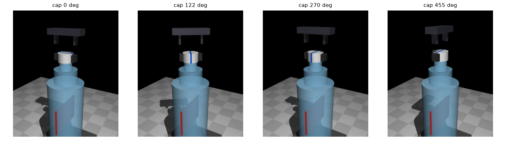
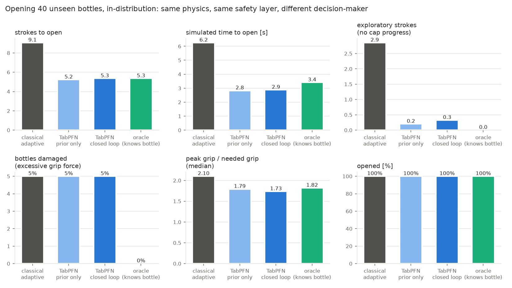
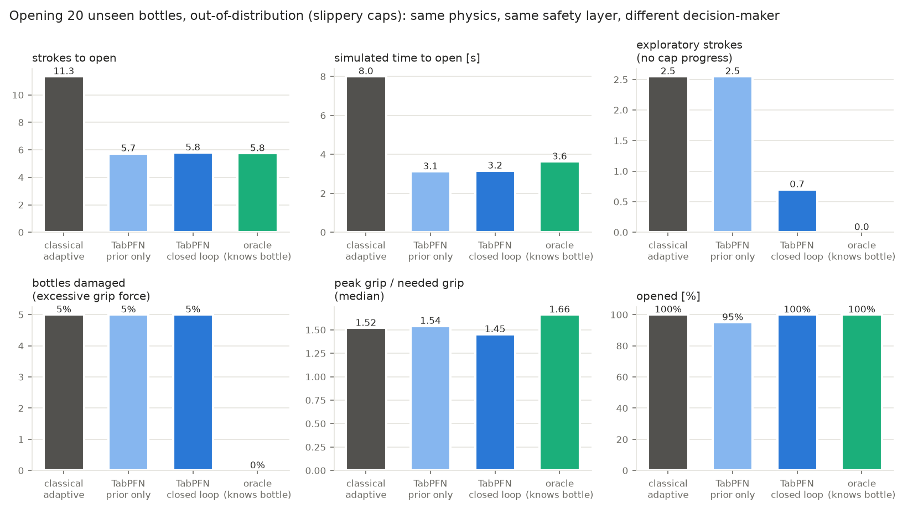
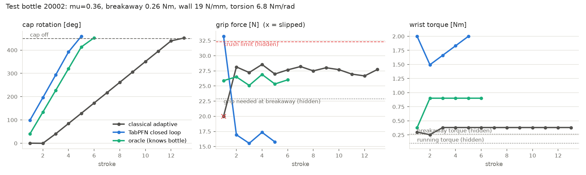

# Opening an unfamiliar bottle with TabPFN (MuJoCo proof of concept)

Research question: can a robot open a plastic bottle it has never seen by **closed-loop
exploration**? It takes small, safe twist strokes, observes how the cap and bottle respond,
uses **TabPFN** to predict the outcome of candidate next strokes, and picks the most promising
one. The core loop is **Act → Observe → Predict → Optimize → Act**.



## Results

All controllers share the same physics, the same safety layer and the same 40-stroke limit.
Time is simulated time; cloud latency is excluded and listed separately.

**40 unseen in-distribution bottles** (properties drawn from the training ranges):

| controller | opened | strokes | time [s] | exploratory strokes | slip strokes | bottles damaged | peak / needed grip |
|---|---|---|---|---|---|---|---|
| classical adaptive | 100 % | 9.1 | 6.2 | 2.9 | 0.0 | 5 % (2) | 2.10 |
| TabPFN prior only | 100 % | 5.3 | 2.9 | 0.3 | 0.3 | 5 % (2) | 1.78 |
| **TabPFN closed loop** | 100 % | **5.3** | **2.9** | **0.3** | 0.3 | 5 % (2) | **1.73** |
| oracle (knows the bottle) | 100 % | 5.3 | 3.4 | 0.0 | 0.0 | 0 % | 1.82 |

**20 unseen out-of-distribution bottles** (slippery caps, μ 0.22–0.4, below anything in the
prior):

| controller | opened | strokes | time [s] | exploratory strokes | slip strokes | bottles damaged | peak / needed grip |
|---|---|---|---|---|---|---|---|
| classical adaptive | 100 % | 11.3 | 8.0 | 2.5 | 1.2 | 5 % (1) | 1.52 |
| TabPFN prior only | **95 %** | 5.7 | 3.1 | 2.5 | 2.5 | 5 % (1) | 1.54 |
| **TabPFN closed loop** | 100 % | **5.8** | **3.2** | **0.7** | 0.8 | 5 % (1) | **1.45** |
| oracle (knows the bottle) | 100 % | 5.8 | 3.6 | 0.0 | 0.0 | 0 % | 1.66 |

Strokes and time are means over opened bottles. Exploratory strokes, slip strokes and damage
are means per bottle. "Bottles damaged" is the share of bottles with at least one stroke over
the hidden crush limit. Peak / needed grip is a median.




### What the results show

1. **TabPFN opens unfamiliar bottles about 1.7–1.9× faster than the classical controller,
   with far fewer wasted strokes.** In-distribution: 5.3 vs 9.1 strokes, 2.9 vs 6.2 s, 0.3 vs
   2.9 exploratory strokes. Out-of-distribution: 5.8 vs 11.3 strokes. It does this with *less*
   grip force relative to what is needed (median 1.73× vs 2.10×). It matches the oracle's stroke
   count.
2. **It found a strategy the hand-written controllers missed.** After the seal breaks, only
   the running torque has to pass through the fingers. TabPFN therefore drives the wrist hard
   (mean τ ≈ 1.9 Nm) with *low* grip (≈ 31 N). Strokes finish in 0.54 s instead of 0.64–0.69 s,
   which is why it beats the oracle's *time*. The oracle is a knowledge-based heuristic, not a
   time-optimal policy, so it is an upper bound on knowledge, not on speed.
3. **The bottle's own strokes help mainly when the prior is wrong, and the evidence is thin.**
   In-distribution, the closed-loop and prior-only variants behave the same (same first
   stroke, same two damaged bottles, near-identical means): the
   running-estimate features (stiffness, friction bounds, seal state) already carry what the
   robot learns about the bottle. Out-of-distribution, the prior-only variant failed on one
   bottle, 20002 (μ = 0.36):
   - it dropped to 8 N grip
   - the prior kept predicting 70–90° of progress for a cap more slippery than any training
     cap
   - it repeated the same slipping stroke 37 times

   The closed-loop variant opened that bottle in 5 strokes, but it never chose 8 N, so this
   shows the failure mode of an open-loop prior rather than proof of recovery. On the other 19
   OOD bottles the two variants behave the same. More OOD cases are needed before claiming a
   systematic benefit.
4. **Excessive force is *not* solved: every non-oracle controller damaged 5 % of bottles.**
   TabPFN's damage always happens on the **first, blind grasp**, before any stiffness has been
   measured. The first stroke is the same for every bottle (33 N / 2.0 Nm), and the softest
   caps crush below 33 N. A tighter chance constraint while stiffness is unknown (1 % instead
   of 5 %) lowered the first grasp from 41 N to 33 N. That traded one damaged bottle for
   another, but it did not remove the problem. The classical controller damages bottles later,
   on its third stroke, when grip escalation overshoots.



### TabPFN as a component

- **Latency:** median 3.3 s, p90 4.6 s per decision (cloud API: a fit plus a predict on about
  4,000 context rows and 432 query rows). That is roughly 6× longer than a stroke. A real robot
  needs local TabPFN inference, a smaller candidate set, or predictions computed during the
  regrasp.
- **Prediction error for the chosen action:**
  - progress: 15° mean absolute error (18° out-of-distribution)
  - slip: 1.8°
  - damage probability: 0.01
- **Rate limit:** the cloud API allows 1000 fit calls per hour, and every decision is one fit.
  A full evaluation (both sets, both TabPFN variants) needs about 700. The controller now waits
  out HTTP 429 errors and retries; the wait is not counted as latency.

### Limitations and next steps

- **Blind first grasp.** The most direct fix is a low-level stiffness probe: measure
  deflection against force during the light-contact ramp, before committing to a grip force.
  That would give every controller a stiffness estimate at stroke 0 and should remove most
  first-stroke damage.
- **Small test sets** (40 + 20 bottles, one seed each). Differences of one bottle (5 %) are not
  meaningful.
- The out-of-distribution set varies only friction and breakaway torque. A stronger test of
  in-episode learning would also shift the crush–stiffness relationship, since that is
  learned only from the prior.
- The classical controller is hand-tuned once, not optimized. A better-tuned rule set would
  narrow the gap, but it would also need re-tuning for each new bottle population, which is the
  point of learning from data.

## The setup

### Physics (`scene.xml`, `sim.py`)

- **Bottle:** sits in a fixture and twists about its axis on a torsion spring (per-bottle
  stiffness). Soft bottles wind up under torque and spring back when released.
- **Cap:** a rigid cylinder (r = 16 mm) on a hinge relative to the neck. A thread equality
  lifts it 3 mm per turn. It is off after 1.25 turns (450°).
- **Seal and thread friction:** dry friction on the cap hinge. It holds up to the
  **breakaway torque**, and once the cap has moved it drops to the lower **running torque**
  for good.
- **Gripper:** floats above the cap (the arm is abstracted away). It has two parallel fingers
  with force-controlled grip, a torque-controlled wrist with viscous damping, and a passive
  vertical slide that follows the thread.
- **Finger–cap contact:** real MuJoCo contact friction (elliptic cone), so **slip happens
  physically** whenever the torque exceeds roughly μ·F·2r.

**Hidden per-bottle properties.** Sampled per seed and never visible to any controller
except the oracle. Only openable bottles are kept: the needed grip, with margin, must be
below the crush force.

| property | range | effect |
|---|---|---|
| cap friction μ | 0.4 – 1.1 | grip force needed to transmit torque without slip |
| breakaway torque | 0.3 – 1.6 Nm | wrist torque needed to break the seal |
| running torque | 15 – 45 % of breakaway | torque needed to keep the cap turning |
| wall stiffness | 15 – 60 N/mm | deflection under grip (observable by the fingers) |
| crush limit | 0.9 – 2.6 mm deflection, correlated with stiffness plus scatter | grip force above k·d_lim damages the cap |
| bottle torsional stiffness | 2 – 12 Nm/rad | wind-up, which delays and absorbs torque |

The bottles are split by seed: **150 training bottles** (seeds 0–149), used only for prior
data, and **40 test bottles** (seeds 10000–10039), never seen before evaluation.

### One action = one twist stroke

Each action is a pair: grip force F (N) and wrist torque τ (Nm). A stroke runs like this:

1. Close the fingers: light contact, then ramp up to F.
2. Ramp up τ and hold it for at most 0.35 s, or until the wrist has turned 90°.
3. Release the torque, then the grip, and let the bottle unwind.
4. Regrasp: rotate the wrist back with the fingers open. This is kinematic and costs 0.15 s.

A stroke takes 0.72 s of simulated time.

**Observations after each stroke** (with sensor noise):
- cap progress relative to the bottle (vision)
- slip between wrist and cap
- peak grip force and wall deflection (finger encoders)
- peak bottle twist
- a damage flag

### Low-level safety controller (`sim.SafetyController`)

This layer runs at the physics rate (2 kHz) and is the same for every controller. It knows
only generic limits, never the bottle's properties:
- clamps commands to F ≤ 100 N and τ ≤ 2 Nm, and ramps them
- **slip watchdog:** if the wrist spins more than 4 rad/s faster than the cap for 20 ms,
  it cuts the torque
- **twist watchdog:** if the bottle twists more than 50°, it cuts the torque
- **deflection watchdog:** at a generic 2.6 mm it releases the grip. This bounds the
  severity of a crush, but it cannot prevent bottle-specific damage below 2.6 mm. Avoiding
  that is the high-level controller's job.

### Controllers (`controllers.py`)

All controllers see the same observations and differ only in how they choose the next
stroke.

| controller | how it chooses (F, τ) |
|---|---|
| **classical adaptive** | Hand-tuned escalation, no learning across bottles. Starts at F = 20 N and τ = 0.3 Nm. With no progress, it raises τ by ×1.3 + 0.05. After a slip, it raises F by ×1.4, or to 1.3·τ/(2r·μ̂) using the running friction estimate. While the cap moves slowly, it raises τ by ×1.15. It caps F at the stiffness estimate × 1.5 mm (a generic deflection budget) and backs off after damage. |
| **TabPFN closed loop** | **Predict:** one cloud TabPFN regressor (target index as a feature) predicts *progress*, *slip* and *damage* for 144 candidate strokes (a 12 × 12 grid of F and τ). Its in-context data is 1200 prior strokes from training bottles plus **every stroke so far on the current bottle**. **Optimize:** score = progress − 0.5·slip − 0.04·F − 2·τ − 50·P(damage), subject to P(damage) ≤ 0.05 (≤ 0.01 before the first stiffness measurement) and the predicted deflection staying under the generic limit. |
| TabPFN prior only | Ablation: the same predictor and optimizer, but without the current bottle's own strokes in the context. It still uses the running estimates as features. |
| oracle | Knows the hidden properties: about 1.25× breakaway torque, then running torque + 0.8 Nm, with 1.3× the needed grip. An **evaluation-only** upper bound. |

**Features (`features.py`).** All are observable and computed from this bottle's stroke
history, with NaN until something becomes observable. TabPFN handles the missing values:
- number of strokes so far
- whether the seal has broken
- wall stiffness estimate (force / deflection)
- largest torque the cap has held
- lower and upper bounds on friction, from strokes that held and strokes that slipped
- torsional stiffness estimate
- smallest torque that moved the cap
- last progress and last slip
- damage count
- the candidate action, its required friction τ/(2rF) and its predicted deflection F/k̂

**Prior data (`generate_prior.py`).** Random strokes on the 150 training bottles, with
log-uniform F and uniform τ, up to 25 strokes per bottle. This gives about 1650 rows that
cover hold, break, slip and crush.

## Simplifications (deliberate)

- **No arm, fixed bottle.** The gripper floats above a bottle in a fixture. The regrasp
  (wrist back to 0°) is kinematic with a fixed time cost.
- **Wall deflection is analytic,** not simulated: deflection = (measured pad normal force) /
  (wall stiffness). The cap is rigid in MuJoCo. Damage is a flag raised when deflection
  exceeds the hidden crush limit. It does not change the geometry, so a damaged cap still
  opens normally.
- **Seal and thread** are a hinge with switched dry friction (breakaway → running) and a
  linear thread equality. There is no thread geometry, no torque that rises with lift, and no
  cross-threading. Below breakaway the cap creeps by about 1°/s because of MuJoCo's soft
  friction constraint. The seal counts as broken once the cap moves more than 1.5° within
  one stroke or faster than 0.4 rad/s.
- **Sensing is idealized:** cap and bottle angles come from "vision" with 0.5° noise, and
  the damage flag is observed directly.
- **No gravity.** It is irrelevant for twisting a cap.
- **Contact tuning:** the finger pads use stiff direct contact parameters
  (`solref="-2e5 -200"`) and `impratio=100`, so static friction holds without creep.
- **Time** is simulated time only. TabPFN's cloud latency (about 3–4 s per decision) is
  measured and reported but not added to the opening time. A real system would need a local
  model or batching (see the latency section).

## Run

```bash
cd bottle_open
python -m venv .venv && .venv/Scripts/python -m pip install -r requirements.txt   # Windows path
python test_physics.py                          # 10 physics / pipeline checks
python generate_prior.py                        # prior strokes on the training bottles -> data/prior.npz
python evaluate.py --controllers classical oracle              # in-distribution (default --set test)
python evaluate.py --set ood --controllers classical oracle    # out-of-distribution slippery caps
python evaluate.py --controllers tabpfn tabpfn_prior_only     # needs TABPFN_TOKEN, about 25 min per set
python evaluate.py --set ood --controllers tabpfn tabpfn_prior_only
python evaluate.py --summary                    # table -> results/summary_test.json (add --set ood)
python analyze.py                               # chosen actions, damage strokes, latency, prediction error
python plot_results.py 10000 20002              # figures -> results/
python view.py --controller classical --seed 10000            # MuJoCo viewer replay
```

### Watch the episodes in MuJoCo

```bash
python explorer.py                       # starts on slippery bottle 20002, TabPFN closed loop
python explorer.py --tour                # guided tour: the 8 most instructive episodes, with captions
```

In tour mode Up / Down step through the cases and each case advances automatically after its
result is shown. Changing bottle or controller by hand leaves the tour.

Everything is chosen with the keyboard inside the viewer window. The overlay shows the bottle's
hidden properties, the current stroke (grip, torque, progress, slip, damage) and the result.

| key | action |
|---|---|
| Up / Down | next / previous bottle |
| Insert | switch between in-distribution (40) and slippery caps (20) |
| Home / End | previous / next controller |
| Enter | pause / resume |
| Page Up / Page Down | faster / slower (0.1× to 2×) |
| Delete | restart the episode |

Episodes are re-simulated from the actions cached by `evaluate.py`, so they match the
evaluation exactly and need no TabPFN calls. Switching takes about 0.7 s, or a few seconds for
a 40-stroke episode. `python view.py --controller tabpfn --seed 20002 --cached` replays a
single episode without the overlay.

Results are cached per (controller, bottle) in `data/results/`, so interrupted TabPFN runs
resume. Use `--fresh` to recompute, and `--seeds 10016 10017 ...` to (re)run selected bottles only.
After a long run, check the log: the exit code alone does not prove every bottle finished.
