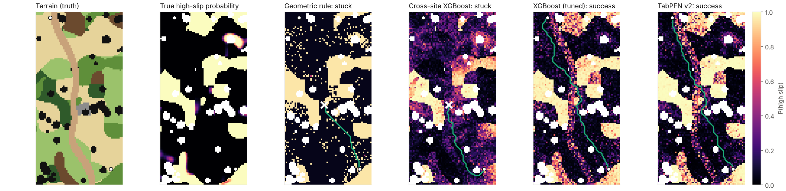
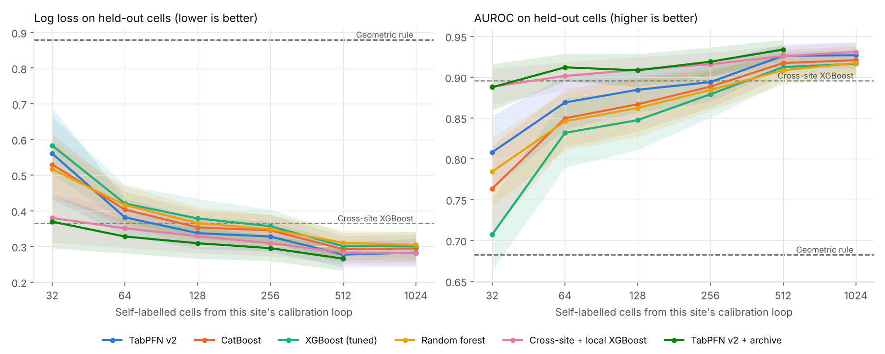

# TabPFN for site-adaptive traversability: a wheeled robot with a lidar

A small, fully simulated project showing where TabPFN is useful in robot
navigation: learning how drivable the terrain is at a **new site from a few
hundred self-labelled cells**, with no training step and calibrated
probabilities that a planner can act on directly.

An 83-second explainer video is in [video/tabpfn_terrain_navigation.mp4](video/tabpfn_terrain_navigation.mp4).



*One mission on unseen terrain. The geometric rule and the model trained on
other sites both treat dry, sloped sand as safe and get stuck (x). TabPFN,
given 256 cells from this site's calibration loop, routes around it.*

## Problem

A wheeled robot with a 3D lidar is deployed at a new outdoor site every few
days. Pure geometry fails in both directions: tall grass that can be driven
through looks like an obstacle, while wet clay or loose sand looks flat and
safe. How each surface behaves depends on the site (soil, moisture, vegetation
species, the robot unit's sensor calibration), so a model trained once on old
sites transfers imperfectly.

At each site the robot drives a short calibration loop. Every cell it crosses
gets a label from its own wheel slip (measured slip > 0.45 = "high slip"). From
those **32 to 1,024 labelled rows** a model predicts, for every other cell,
the probability of high slip from 10 lidar statistics:

| Feature | Meaning |
|---|---|
| `range_m`, `n_points` | distance when observed, lidar returns in the cell |
| `h_max`, `h_std`, `roughness`, `slope_deg` | geometry of the points |
| `multi_echo`, `ground_frac` | how much the beam penetrates (vegetation) |
| `int_mean`, `int_std` | lidar intensity (uncalibrated, gain differs per robot unit) |

Far cells have few points, so features are often missing (about 23% of rows
have a NaN).

## What's in the simulation

`terrain_sim.py` generates 60 m x 60 m sites at 0.5 m resolution with seven
terrain types (track, short grass, tall grass, bush, mud, sand, rubble), a
height map, a moisture field, trees and boulders. Hidden site parameters change
the physics:

- **wetness x clay**: wet clay tracks and mud become slippery, wet sand gets firmer
- **dry sand on slopes**: loose and slippery, but flat and bright in the lidar
- **vegetation species stiffness and season**: the same tall-grass signature is
  passable at one site and tangles the wheels at another
- **loose vs. locked rubble**: changes which rock size is a problem
- **per-unit lidar calibration**: intensity gain and a height offset

## Experiments

**1. Prediction quality vs. labelled cells** (`benchmark.py`, `benchmark_archive.py`).
Ten test sites. Models are trained on calibration cells from the left half
of each site and evaluated on 1,000 cells from the right half. Compared:

- TabPFN v2 (default settings, 8 estimators, CPU)
- CatBoost, XGBoost, LightGBM (defaults), XGBoost tuned by a 20-candidate randomized search with 3-fold CV
- Random forest, MLP, logistic regression (median imputation + missing indicators)
- Geometric rule: hand-tuned height, roughness and slope thresholds
- Cross-site XGBoost: trained on 20,000 rows from 20 other sites, no local data
- Cross-site + local XGBoost: the 20,000 archive rows plus the local rows, local rows weighted up
- TabPFN v2 + archive: the local rows plus 512 archive rows in TabPFN's context, with an `is_local` flag column

**2. Closed-loop navigation** (`navigate.py`). Eight further sites, 8 missions
each (start at the bottom, goal 50 to 60 m away at the top of the unseen half).
A* plans on each method's predicted costmap (step cost = distance x (1 + 30 p)).
Each time the robot enters a cell it gets stuck with that cell's true stuck
probability. Random draws are shared across methods, so all face the same luck.
Learned models get 256 local cells. A mission only counts if a safe route exists.

## Results



Mean over 10 sites (log loss: lower is better):

| Model | Log loss @64 | AUROC @64 | Log loss @256 | AUROC @256 |
|---|---|---|---|---|
| **TabPFN v2** (local only) | **0.382** | **0.869** | **0.328** | **0.894** |
| CatBoost | 0.403 | 0.850 | 0.345 | 0.888 |
| Random forest | 0.416 | 0.846 | 0.348 | 0.884 |
| XGBoost (tuned) | 0.420 | 0.832 | 0.357 | 0.879 |
| Logistic regression | 0.473 | 0.822 | 0.405 | 0.845 |
| LightGBM | 0.462 | 0.835 | 0.457 | 0.874 |
| XGBoost | 0.510 | 0.844 | 0.466 | 0.873 |
| MLP | 0.965 | 0.802 | 0.752 | 0.847 |
| Geometric rule | 0.880 | 0.683 | 0.880 | 0.683 |
| Cross-site XGBoost (no local data) | 0.365 | 0.896 | 0.365 | 0.896 |
| Cross-site + local XGBoost | 0.351 | 0.901 | 0.309 | 0.916 |
| **TabPFN v2 + archive** | **0.328** | **0.912** | **0.295** | **0.919** |

Navigation, 64 missions per method:

| Method | Missions completed | Stuck | Mean path (successes) |
|---|---|---|---|
| No terrain model (obstacles only) | 11% | 89% | 54 m |
| Geometric rule | 48% | 52% | 61 m |
| Cross-site XGBoost | 67% | 33% | 71 m |
| XGBoost (tuned) | 69% | 31% | 64 m |
| Cross-site + local XGBoost | 73% | 27% | 68 m |
| CatBoost | 75% | 25% | 64 m |
| **TabPFN v2** | **81%** | **19%** | 65 m |
| Oracle (true slip known) | 98% | 2% | 61 m |

## What this shows, honestly

- **Among models that only see local data, TabPFN is the best choice** from 64
  labelled cells on: lowest mean log loss, highest AUROC at every size, and a
  mean per-site rank of 1.1 to 1.7 out of 8 (CatBoost, the next best, 2.1 to
  2.8). At 32 cells random forest and CatBoost have slightly lower mean log
  loss, though TabPFN still has the highest AUROC and the best mean rank. Its
  edge shrinks as data grows: at 1,024 cells the tree models are close.
- **Having an archive of earlier sites matters a lot.** Pooled XGBoost with
  local data beats local-only TabPFN below about 256 cells and ties it from 512.
  Given just 512 archive rows in context plus an `is_local` flag, TabPFN has the
  best mean log loss at every size tested. Site by site that is not a sweep: it
  beats pooled XGBoost on 4 to 7 of the 10 sites depending on the size.
- **Navigation follows the prediction quality.** TabPFN completes 81% of
  missions against 75% for CatBoost and 48% for the geometric rule. Paired
  over the same 64 missions, TabPFN succeeds where CatBoost fails 9 times and the
  reverse happens 5 times (7 vs. 2 against pooled + local XGBoost, 24 vs. 3
  against the geometric rule). With 64 missions the gaps to the best learned
  baselines are suggestive, not conclusive.
- **Cost:** TabPFN takes 4 to 13 s per fit-and-predict on a 2-core CPU, against
  about 1 s for CatBoost. On a robot you would run it off the critical path or
  distil it into a small model, which the newer TabPFN releases support.
- **It's a simulation.** I designed it to contain the site effects in the
  problem definition. The ranking depends on how strongly sites differ: with
  weaker site effects, the cross-site model alone gets better and local
  learning matters less.

## Run it

```bash
pip install -r requirements.txt
export TABPFN_ALLOW_CPU_LARGE_DATASET=1
python benchmark.py            # ~35 min on 2 CPU cores
python benchmark_archive.py    # ~8 min
python navigate.py             # ~20 min
python make_figures.py         # summaries and figures in results/
```

TabPFN v2 needs its weights (`tabpfn-v2-classifier-finetuned-zk73skhh.ckpt`,
29 MB, Prior Labs License) from huggingface.co/Prior-Labs/TabPFN-v2-clf. The
code selects v2 explicitly because newer TabPFN releases are gated. Run the
scripts one at a time: on a small machine, two runs in parallel slow each
other down badly through OpenMP thread contention.

## Files

| File | Purpose |
|---|---|
| `terrain_sim.py` | site generator, lidar feature model, slip labels |
| `models.py` | model zoo, geometric rule, calibration error |
| `benchmark.py` | learning curves for all models |
| `benchmark_archive.py` | TabPFN with archive rows in context |
| `navigate.py` | A* missions on predicted costmaps |
| `make_figures.py` | summaries (`results/*.csv`) and figures |
| `make_video.py` | 83-second explainer video from the results (`python make_video.py`) |
| `results/` | raw and summarised results, figures, saved paths and risk maps |
